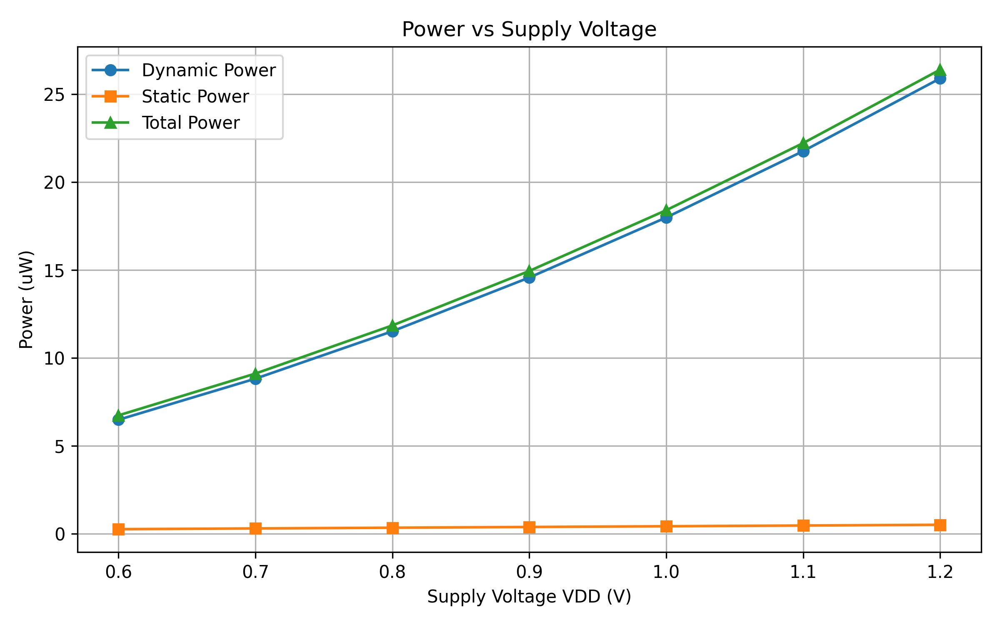
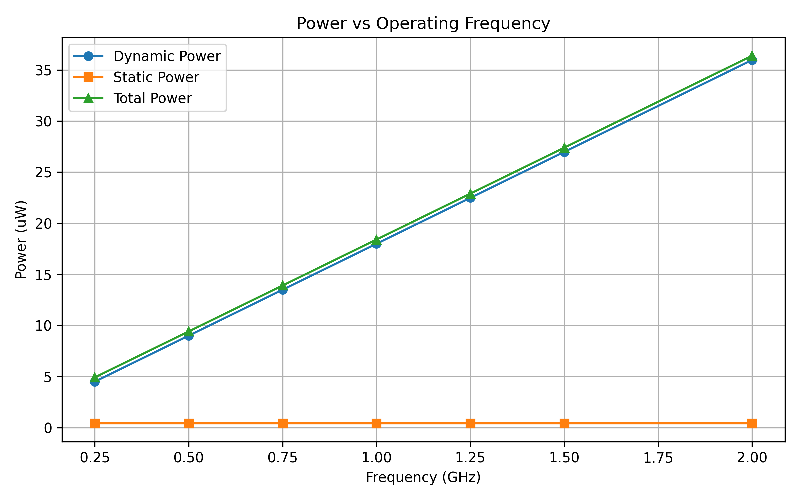
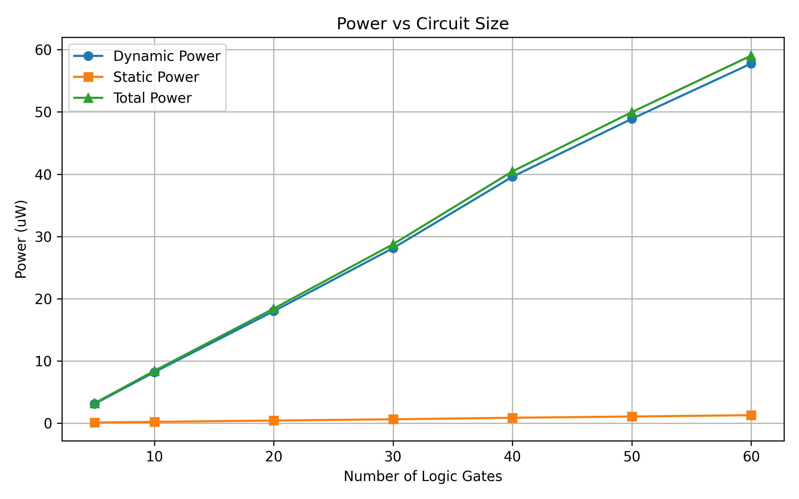

# Random-Circuit Power Estimator

A Python-based tool for generating random combinational gate-level circuits, simulating switching activity, and estimating dynamic, static, and total power.

The project also performs automated validation sweeps for supply voltage, operating frequency, circuit size, and reproducibility.

> **Note:** The standard-cell parameters used in this project are illustrative generic values. They are intended for algorithm development, simulation, and comparative analysis—not silicon-accurate power sign-off. Physical correlation would require characterized Liberty/PDK data.

---

## Overview

The **Random-Circuit Power Estimator** models a small digital standard-cell environment and estimates circuit power from simulated switching activity.

The complete flow is:

```text
Random Circuit Generation
          ↓
   DAG Construction
          ↓
 Random Input Vectors
          ↓
 Logic Simulation
          ↓
 Toggle Measurement
          ↓
 Switching Activity (α)
          ↓
 Dynamic + Static Power
          ↓
 CSV Reports
          ↓
 Validation Sweeps
          ↓
 Validation Plots
```

---

## Features

* Random combinational circuit generation
* DAG-based gate-level representation
* Support for common logic gates
* Random-vector functional simulation
* Per-gate switching activity measurement
* Dynamic power estimation
* Static/leakage power estimation
* Total power estimation
* Fanout-dependent load capacitance
* CSV report generation
* Supply-voltage sweep
* Frequency sweep
* Gate-count sweep
* Reproducibility validation
* Automated quantitative validation
* Matplotlib-based validation plots

---

## Supported Gates

| Gate  | Inputs | Output Capacitance | Leakage Current |
| ----- | ------ | ------------------ | --------------- |
| INV   | 1      | 2.0 fF             | 15 nA           |
| BUF   | 1      | 3.0 fF             | 18 nA           |
| AND2  | 2      | 3.5 fF             | 22 nA           |
| OR2   | 2      | 3.5 fF             | 22 nA           |
| NAND2 | 2      | 3.0 fF             | 20 nA           |
| NOR2  | 2      | 3.0 fF             | 20 nA           |
| XOR2  | 2      | 5.0 fF             | 28 nA           |
| XNOR2 | 2      | 5.0 fF             | 28 nA           |

The values above are illustrative technology-model parameters used for simulation.

---

## Power Model

### Dynamic Power

The project uses the conventional switching-power relationship:

$$
P_{dynamic} =
\alpha \cdot \frac{1}{2} C_{load} V_{DD}^{2} f
$$

where:

* \(\alpha\) = measured switching activity
* \(C_{load}\) = output capacitance plus fanout wiring capacitance
* \(V_{DD}\) = supply voltage
* \(f\) = operating frequency

### Static Power

Leakage power is estimated using:

$$
P_{static}=V_{DD}I_{leak}
$$

### Total Power

$$
P_{total}=P_{dynamic}+P_{static}
$$

---

## Switching Activity

Random primary-input vectors are applied to the generated circuit.

For each gate:

$$
\alpha =
\frac{\text{number of output transitions}}
{\text{number of vector transitions}}
$$

The first input vector establishes the initial circuit state. Toggle counting begins from the second vector so that every counted transition occurs between two actual simulated vectors.

---

## Circuit Generation

The circuit is represented as a **Directed Acyclic Graph (DAG)**.

Primary inputs are generated first, followed by logic gates.

Each new gate can only connect to previously created nodes:

```text
PI0 ─────┐
         ├── AND2 ─────┐
PI1 ─────┘             │
                       ├── XOR2 ─── Output
PI2 ─────┐             │
         ├── OR2 ──────┘
PI3 ─────┘
```

This ordering guarantees that the circuit can be evaluated in a forward pass without combinational loops.

---

## Project Structure

```text
random-circuit-power/
│
├── .gitignore
├── README.md
├── requirements.txt
│
├── cell_library.py
├── circuit_generator.py
├── power_calculator.py
├── main.py
├── validation.py
├── validation_analysis.py
├── plot_results.py
│
└── results/
    ├── power_report.csv
    ├── validation_frequency.csv
    ├── validation_gates.csv
    ├── validation_vdd.csv
    │
    └── plots/
        ├── frequency_vs_power.png
        ├── gates_vs_power.png
        └── vdd_vs_power.png
```

---

## Installation

### 1. Clone the repository

```bash
git clone <repository-url>
cd random-circuit-power
```

### 2. Create a virtual environment

Windows PowerShell:

```powershell
python -m venv .venv
```

### 3. Activate the environment

```powershell
.venv\Scripts\Activate.ps1
```

### 4. Install dependencies

```powershell
pip install -r requirements.txt
```

---

## Basic Usage

Run the default configuration:

```powershell
python main.py
```

Example configuration:

```powershell
python main.py --inputs 6 --gates 20 --vectors 2000 --seed 42
```

Specify supply voltage and frequency:

```powershell
python main.py --inputs 10 --gates 60 --vectors 5000 --vdd 0.9 --freq 1.5e9 --seed 7
```

---

## CSV Export

Generate a per-gate power report:

```powershell
python main.py --inputs 6 --gates 20 --vectors 2000 --seed 42 --csv results\power_report.csv
```

The report contains:

* Node index
* Gate type
* Fanout
* Load capacitance
* Switching activity
* Dynamic power
* Static power
* Total power

---

## Validation

Run the complete validation suite:

```powershell
python validation.py
```

The validation performs:

### VDD Sweep

Supply voltage:

```text
0.6 V → 1.2 V
```

The expected relationship is:

$$
P_{dynamic}\propto V_{DD}^{2}
$$

### Frequency Sweep

Frequency:

```text
0.25 GHz → 2.0 GHz
```

The expected relationship is:

$$
P_{dynamic}\propto f
$$

### Gate-Count Sweep

Circuit sizes:

```text
5 → 60 gates
```

Power is expected to generally increase as circuit size increases.

### Reproducibility

The same random seed is executed multiple times to verify deterministic results.

---

## Quantitative Validation

Run:

```powershell
python validation_analysis.py
```

The current validation results are:

```text
VDD² scaling error:
0.000000%

Frequency linearity:
R² = 1.0000000000

Gate-count correlation:
R² = 0.999124

Reproducibility:
PASS
```

The VDD and frequency relationships match the implemented mathematical model exactly because the power calculator directly applies the corresponding scaling equations.

---

## Validation Plots

Generate the plots using:

```powershell
python plot_results.py
```

Generated figures:

### VDD vs Power



### Frequency vs Power



### Gate Count vs Power



---

## Example Result

For a default 20-gate circuit:

```text
Dynamic Power : 17.98724 uW
Static Power  : 0.41500 uW
Total Power   : 18.40224 uW
```

For a larger configuration:

```text
Inputs        : 10
Gates         : 60
Vectors       : 5000
VDD           : 0.9 V
Frequency     : 1.5 GHz

Dynamic Power : 71.52190 uW
Static Power  : 1.17270 uW
Total Power   : 72.69460 uW
```

---

## Limitations

This project is intended as a **power-estimation and modeling framework**, not a sign-off power-analysis tool.

Current limitations include:

* Cell parameters are illustrative rather than PDK-characterized.
* Interconnect capacitance is represented using a simple fanout-based model.
* Delay is not currently modeled.
* Glitch power is not explicitly separated from functional switching.
* Generated circuits may contain gates that do not contribute to a selected primary output.
* No Liberty-based timing or power characterization is currently used.
* No physical layout extraction is included.
* The model does not replace commercial or sign-off EDA power analysis.

---

## Future Work

Possible extensions include:

* Liberty-file based cell characterization
* Real PDK integration
* Timing and delay estimation
* Critical-path analysis
* Glitch-aware switching activity
* Multi-output circuit support
* More realistic interconnect models
* Activity-factor prediction using machine learning
* Regression-based power prediction
* Optimization of circuit architectures for power
* Physical-design-aware power estimation

---

## Technologies

* Pyth
